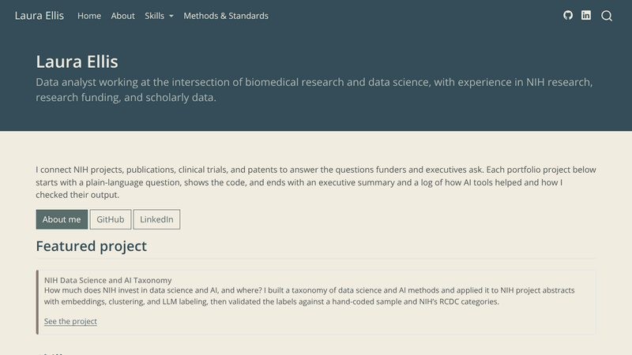

# laura-ellis.github.io

Source for my data portfolio: [laura-ellis.github.io](https://laura-ellis.github.io)



Built with [Quarto](https://quarto.org). One page per skill area, each with an NIH flagship project, a project from another domain, and earlier work.

## Update the site

1. Edit `.qmd` or `.md` pages.
2. Preview locally: `quarto preview`
3. If a page runs code, render it locally first (`quarto render`) and commit the `_freeze/` folder, so the publish step doesn't need Python or R.
4. Push to `master`. GitHub Actions renders the site and publishes it to the `gh-pages` branch.

One-time setup: in the repo's **Settings → Pages**, set the source to the `gh-pages` branch, `/ (root)`.

## Layout

```
_quarto.yml        site config: navigation, theme, footer
custom.scss        Personal palette (Behr 2026) and card styles
fonts.css, fonts/  Open Sans (SIL Open Font License, fonts/OFL.txt)
index.md           home page
about.qmd          about
methods.qmd        taxonomy, FAIR, CRediT, AI validation
skills/            one page per skill area
pdf/, images/      presentation and preview GIF
```

## License

Code: MIT ([`LICENSE`](LICENSE)). Written content, figures, and images: CC BY 4.0 ([`LICENSE-CONTENT.md`](LICENSE-CONTENT.md)). Data keeps each source's terms.
