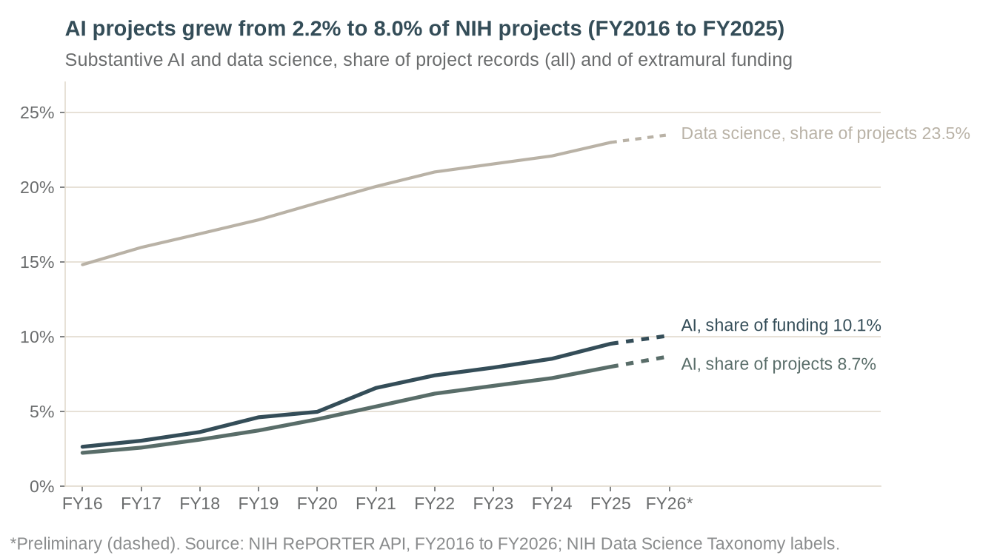
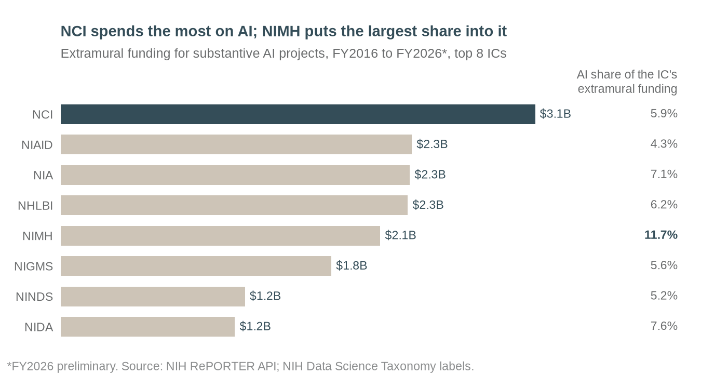
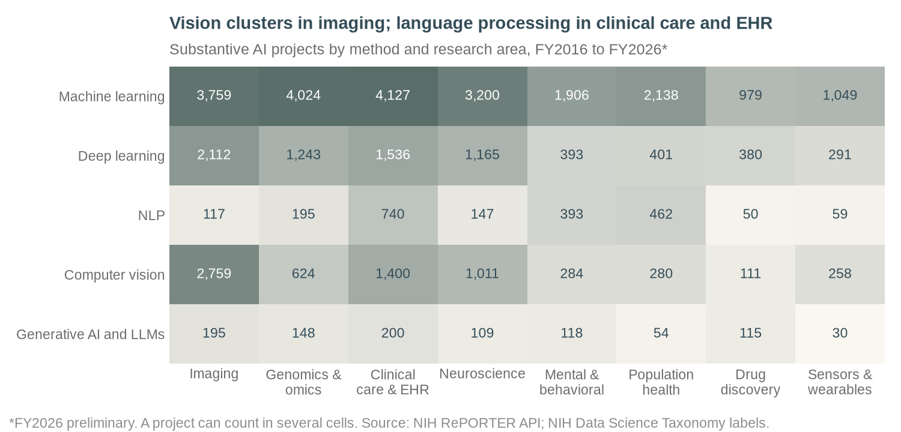
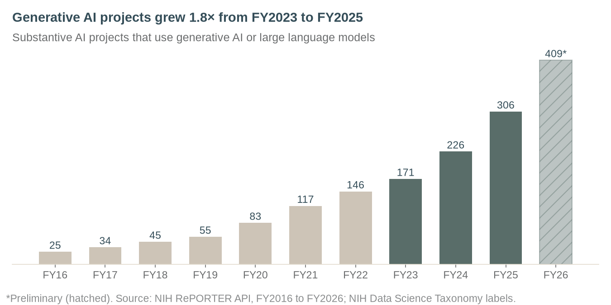

::: {.callout-note appearance="simple"}
**In progress.** This page fills in as the project runs. Text marked [like this]{.todo} is still to come.
:::

## Flagship: NIH Data Science Taxonomy

### Question
Where does AI show up in NIH-funded research, and what do those projects produce?

### Data
NIH RePORTER and ExPORTER project records and abstracts, FY2016–FY2026 (FY2026 preliminary): 258,321 records (parent projects and subprojects, each counted once). Taxonomy tested on a stratified sample of 749 projects (FY2019, FY2022, FY2025) and validated on 150 hand-coded projects.

### Method
1. **Define** a taxonomy of 755 terms in 40 categories (8 dimensions): data science and AI methods, software, infrastructure, data sharing, responsible AI, workforce, and research areas
2. **Flag** projects with keywords (1 strong term or 2 weak terms): 60,245 of 258,321 records
3. **Label** each flagged project with Jev (typed questions with probabilities): substantive, mention, or none, plus AI role and categories
4. **Resolve** calls under 90% confidence with ChatGPT (GPT-6 Luna): 37,415 texts; about $24 in total with Jev
5. **Validate** against 150 hand-coded projects and RCDC (Research, Condition, and Disease Categorization) categories

Agreement is reported as Cohen's kappa: κ = (observed agreement − chance agreement) / (1 − chance agreement). 1 = perfect, 0 = chance. The pipeline reaches κ = 0.92 for AI and 0.86 for data science against hand coding.

### Results
AI went from 2.2% of NIH project records in FY2016 to 8.0% in FY2025, and from $671M to $3.5B in extramural funding (9.5% of the total). FY2026 so far (preliminary): 8.7% of records, 10.1% of funding.

{fig-alt="Line chart: AI share of NIH projects rose from 2.2% in FY2016 to 8.0% in FY2025 (8.7% in preliminary FY2026); AI share of extramural funding rose to 9.5% (10.1% in FY2026); data science share of projects rose from 14.8% to 23.0% (23.5% in FY2026)."}

{fig-alt="Bar chart of extramural AI funding FY2016–FY2026 by institute, top 8: NCI $3.1B leads, then NIAID, NIA, and NHLBI at $2.3B each; NIMH puts the largest share into AI at 11.7%."}

{fig-alt="Heatmap of AI method by research area: machine learning everywhere, computer vision concentrated in imaging, NLP in clinical care and EHR."}

**Generative AI:** Projects using generative AI or large language models doubled from 149 in FY2023 to 296 in FY2025, while AI overall grew 11%. About half develop new generative methods (52%) and 40% apply them; imaging and clinical care are the most common areas.

{fig-alt="Bar chart: generative AI projects by fiscal year, 23 in FY2016 rising to 296 in FY2025."}

**Presentation:** [Impact of AI on Biomedical Research (PDF)](../pdf/impact_of_ai_biomedical_research.pdf).

### Executive summary
- **AI is growing fast but is still a small slice.** About 1 in 13 NIH projects used AI in FY2025, up from 1 in 48 in FY2016.
- **Most projects apply AI rather than build it.** 70% use existing methods; 21% develop new ones.
- **AI projects publish more.** Compared with matched projects from the same institute, activity code, year, and size, AI projects have a median of 12 linked papers vs. 8. Citation impact, patents, and trials are next.

### AI workflow log
[Prompts used, what the AI got wrong, how the output was checked]{.todo}

[Taxonomy repo: nih-ds-taxonomy](https://github.com/Laura-Ellis/nih-ds-taxonomy) · [All analyses using the taxonomy](../projects/nih-ds-taxonomy.qmd)

## Same skills, other domain: Public comments on an NIH policy

Topic and sentiment analysis of public comments on an NIH Request for Information (RFI), for data science policy. [Repo and summary]{.todo}

## Earlier work

::: {.grid}
::: {.g-col-12 .g-col-md-6}
#### NLP with Python: Myriad
[View on original site](https://lauraellis36.wixsite.com/dataportfolio/sas-enterprise-miner-copy) · [GitHub](https://github.com/Laura-Ellis/Python_NLP_Myriad)
:::
::: {.g-col-12 .g-col-md-6}
#### IBM Watson: Gavi Vaccine Alliance
[View on original site](https://lauraellis36.wixsite.com/dataportfolio/decisions-requirement-diagram-copy)
:::
::: {.g-col-12 .g-col-md-6}
#### IBM Watson: PEW Research Science Issues
[View on original site](https://lauraellis36.wixsite.com/dataportfolio/ibm-watson-gavi-vaccine-alliance-co)
:::
:::
