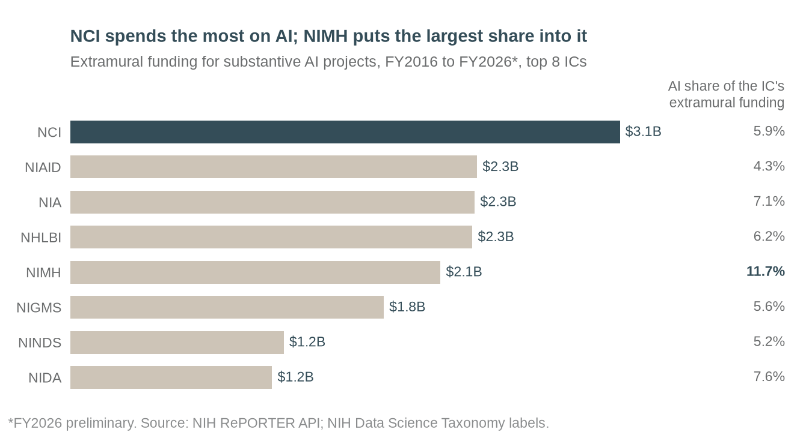
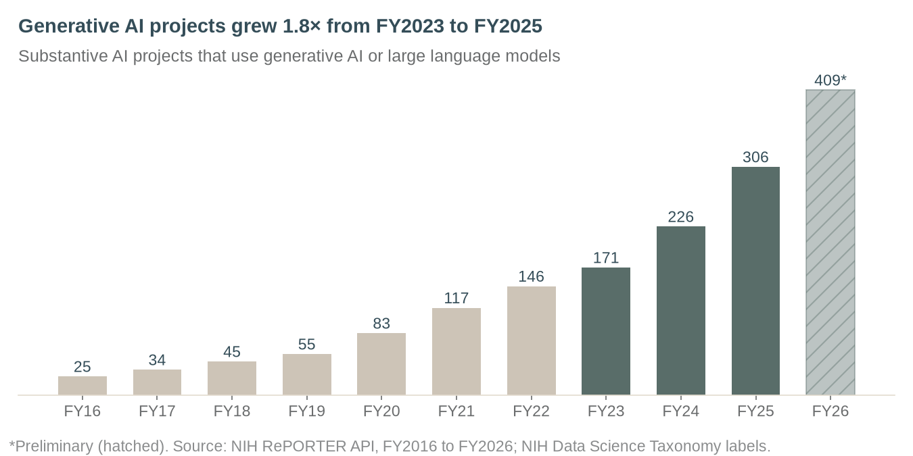

::: {.callout-note appearance="simple"}
**In progress.** This page fills in as the project runs. Text marked [like this]{.todo} is still to come.
:::

## Flagship: NIH AI investment dashboard

### Question
Where is NIH investing in AI, by institute, state, and activity code, and how is that changing?

### Data
NIH RePORTER and ExPORTER projects, FY2016–FY2026 (258,321 records; FY2026 preliminary), labeled with the data science taxonomy from the [NLP & LLMs](nlp-llms.qmd) page. A Tableau extract gives one row per record, fiscal year, and taxonomy group, so every view filters by group, institute (IC), activity code, state, and AI role.

### Method
- Tableau Public dashboard with filters for fiscal year, institute (IC), and activity code
- Action titles that state the takeaway; one highlight color, everything else neutral

### Results
Static versions of the main views (matplotlib), ahead of the Tableau Public build:

{fig-alt="Bar chart of extramural AI funding FY2016–FY2026 by institute, top 8: NCI $3.1B leads; NIMH puts the largest share into AI at 11.7%."}

{fig-alt="Bar chart: generative AI projects grew 1.8 times, from 171 in FY2023 to 306 in FY2025, and 409 so far in preliminary FY2026."}

[Embedded Tableau Public dashboard with group and IC filters]{.todo}

### Executive summary
- **NCI spends the most on AI:** $3.1B over FY2016–FY2026, 5.9% of its extramural portfolio.
- **NIMH, NHGRI, and NIBIB lead on share:** AI is 12% to 19% of their extramural funding.
- **NIAID has the largest extramural portfolio** ($53.6B), so each point of AI share is worth the most there: AI is 4.3% today, with room to grow.

### AI workflow log
[Prompts used, what the AI got wrong, how the output was checked]{.todo}

## NIH data science KPIs

A dashboard of 28 proposed KPIs for the five goals of the NIH Strategic Plan for Data Science, 2025–2030, built from public data. [See the project](../projects/nih-ds-kpis.qmd)

## Infrastructure: Is NIH funding the foundations AI needs?

### Question
How much NIH funding goes to the data, compute, and standards that AI depends on, compared with AI applications?

### Data
NIH RePORTER projects labeled by the taxonomy as infrastructure (data repositories and commons, cloud and compute, standards, software tools) or application. [Record counts]{.todo}

### Method
- Tableau Public view of infrastructure vs. application funding by fiscal year and institute
- Ratio = infrastructure funding / AI application funding, per institute and year

### Results
[Embedded Tableau Public view]{.todo}

### Executive summary
[Three takeaways for a non-technical reader]{.todo}

### AI workflow log
[Prompts used, what the AI got wrong, how the output was checked]{.todo}

## Same skills, other domain: Chart makeover

A before-and-after redesign of one cluttered chart in matplotlib, showing each change and why. [Images and summary]{.todo}

## Earlier work

::: {.grid}
::: {.g-col-12 .g-col-md-6}
#### Tableau
[View on original site](https://lauraellis36.wixsite.com/dataportfolio/excel-copy)
:::
::: {.g-col-12 .g-col-md-6}
#### Excel
[View on original site](https://lauraellis36.wixsite.com/dataportfolio/blank-page-6)
:::
:::
